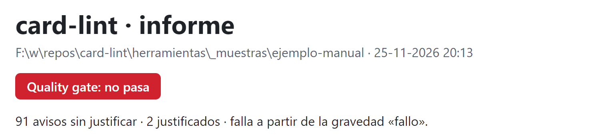
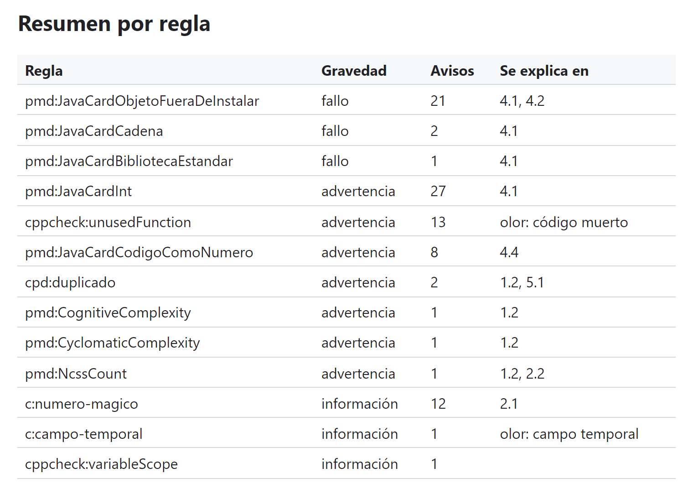
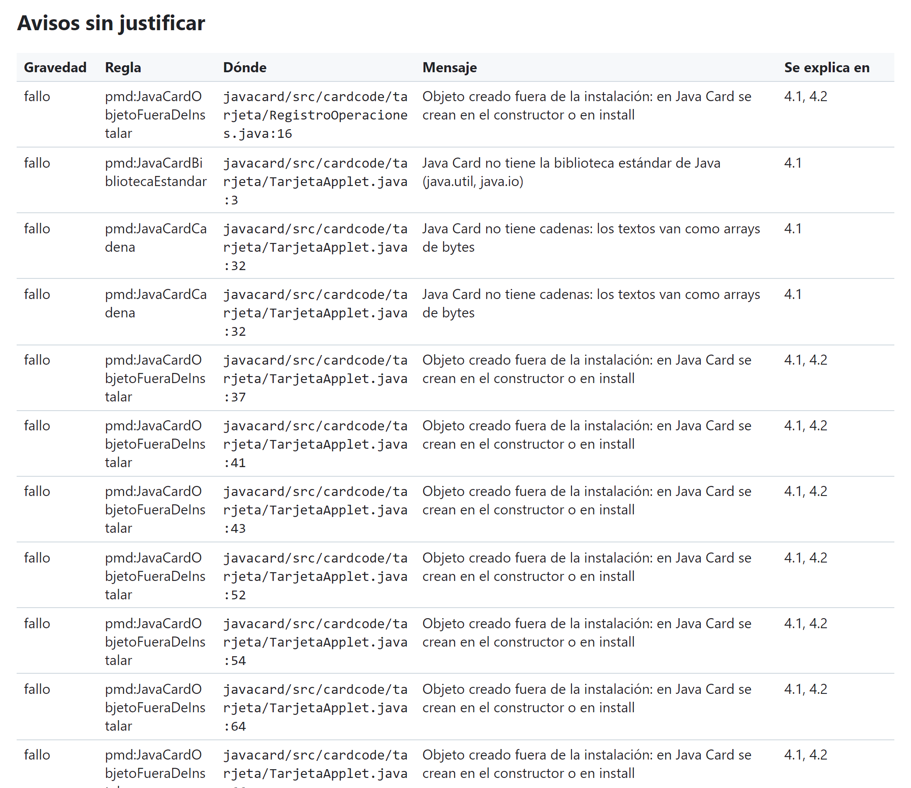
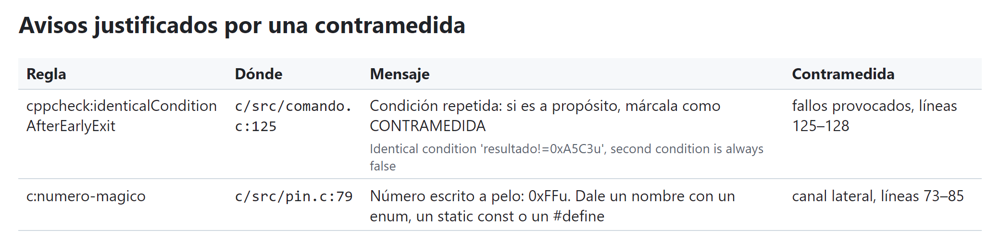
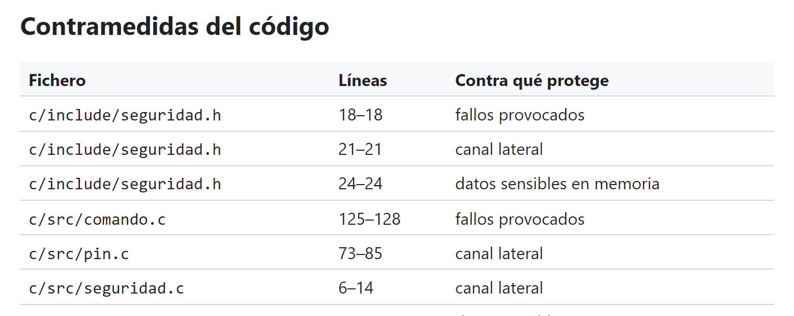
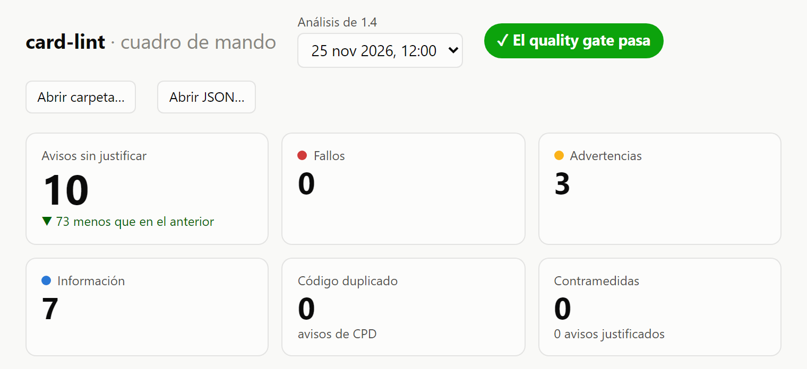
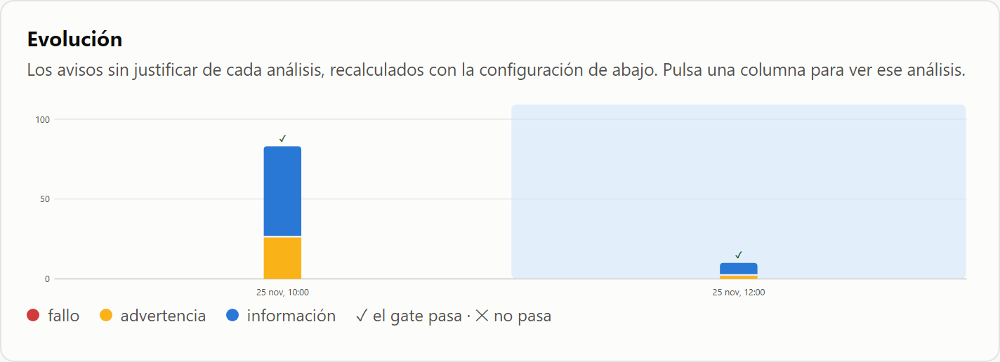
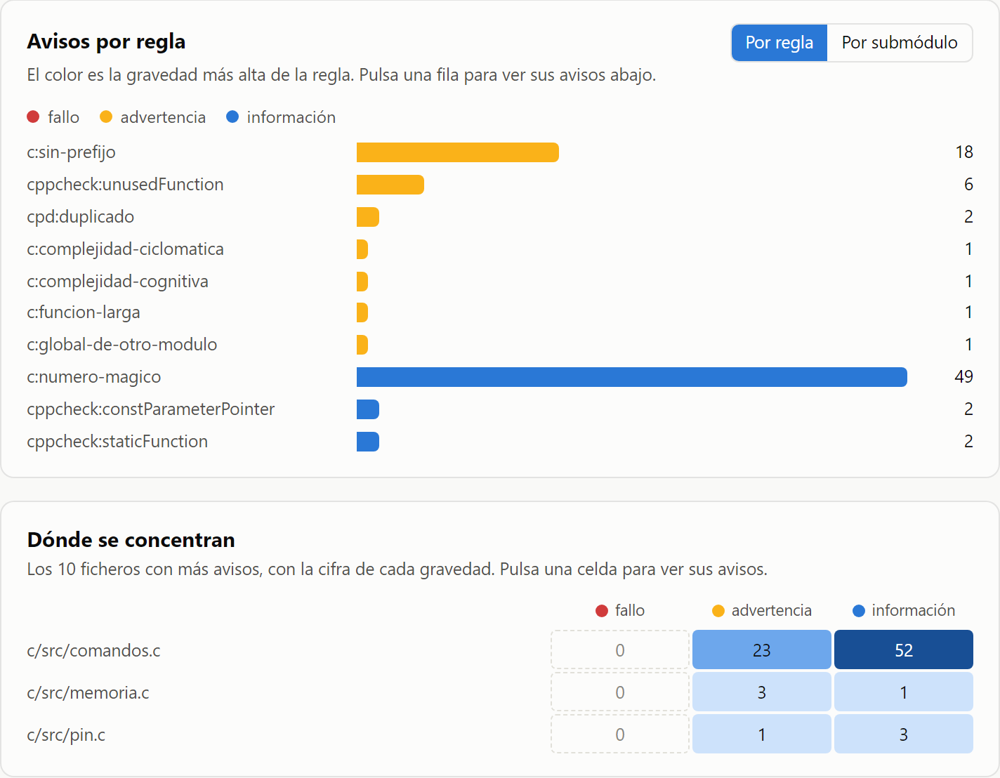
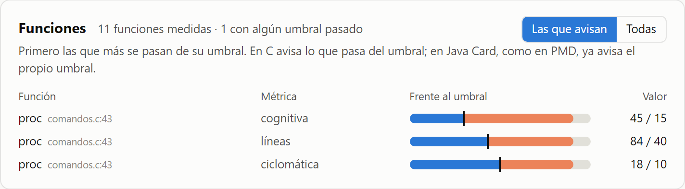
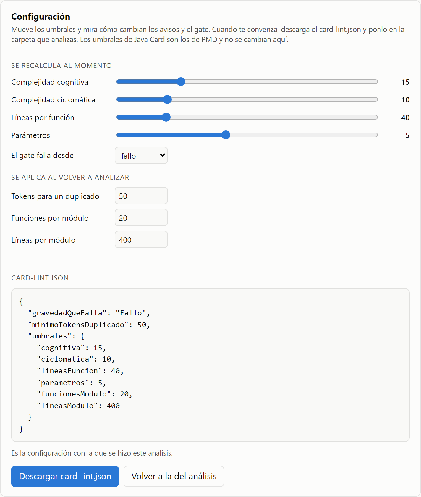

# card-lint

*El analizador de código C y Java Card del curso de código limpio*

card-lint revisa el código C y Java Card de una carpeta y te deja un informe en una página web: los olores que encuentra, las métricas de cada función, las contramedidas que hay en el código y si el conjunto pasa un quality gate. Funciona en tu equipo, sin conexión y sin servidor. Lo que busca es lo que enseña el curso de código limpio, y cada aviso te dice en qué submódulo se explica, así que el informe te sirve también para repasar.

Lleva dentro dos herramientas conocidas que hacen parte del trabajo, Cppcheck para el C y PMD para el Java Card, y les añade reglas propias para lo que ninguna de las dos mira.

Si guardas los análisis, el cuadro de mando que viene con card-lint los pone en fila: ves cómo cambian los avisos de un análisis al siguiente, en qué ficheros se acumulan y qué pasaría con otros umbrales.

## 1. Qué necesitas

- **Windows de 64 bits.**
- **Java 8 o posterior**, que PMD necesita para analizar el Java Card. Si ya compilas applets, lo tienes: el kit de Java Card pide un JDK.
- **Nada más.** card-lint no necesita que instales .NET, y Cppcheck y PMD van en su carpeta.

## 2. Instalarlo

card-lint se entrega como una carpeta. Cópiala donde quieras, por ejemplo en `F:\herramientas\card-lint`, y ya está: no hay instalador ni nada que registrar en el sistema. Dentro tiene esto:

| En la carpeta | Qué es |
|---|---|
| `card-lint.exe` | El programa |
| `cuadro-de-mando.html` | El cuadro de mando, que se abre en el navegador (capítulo 9) |
| `Reglas\` | Las reglas de PMD para Java Card que usa card-lint |
| `herramientas\cppcheck\` | Cppcheck, solo la parte de línea de comandos |
| `herramientas\pmd-bin-7.29.0\` | PMD |
| `licencias\` | Las licencias de Cppcheck y de PMD |

Si mueves el programa, mueve la carpeta entera. card-lint busca `herramientas` al lado de donde está él.

## 3. Analizar una carpeta

Abre PowerShell y escribe:

```powershell
F:\herramientas\card-lint\card-lint.exe analizar F:\proyectos\monedero --salida F:\informes\monedero.html
```

La carpeta que le das tiene que tener la forma del repositorio del curso:

| Carpeta | Qué mira card-lint |
|---|---|
| `c\include\` | Las cabeceras |
| `c\src\` | El código C |
| `c\pruebas\` | Las pruebas, solo para saber qué funciones usan |
| `javacard\src\` | El código del applet |

Si falta alguna, card-lint analiza lo que haya. Si no le das `--salida`, el informe se llama `card-lint-informe.html` y se queda en la carpeta desde la que lo lanzas. Mientras trabaja, card-lint crea una carpeta de trabajo al lado del informe y la borra al terminar. En la carpeta que analizas no escribe nada.

Si además le das `--historial` con una carpeta, card-lint guarda allí cada análisis en un JSON, y el cuadro de mando del capítulo 9 los junta para que veas cómo evoluciona el código.

Al acabar, te resume el análisis en la consola. Esta es la salida del análisis del que salen las capturas de este manual, hecho sobre una carpeta de ejemplo con el repositorio del curso:

```text
Avisos sin justificar: 91 · justificados: 2 · contramedidas: 7
Quality gate: no pasa.
Informe: F:\w\repos\card-lint\docs\manual\informes\informe-ejemplo.html
```

Y te devuelve un código, que es lo que mira un script o la integración continua:

| Código | Significa |
|---|---|
| 0 | El quality gate pasa |
| 1 | El quality gate no pasa |
| 2 | No se ha podido analizar: la carpeta no existe, el comando está mal escrito o falla una herramienta |

## 4. Leer el informe

Abre el HTML en el navegador. Es un solo fichero con el estilo dentro, así que lo puedes guardar, mandar por correo o abrirlo en un equipo sin red.

### La cabecera y el quality gate



Arriba está la carpeta analizada, la fecha y el resultado del quality gate. Debajo, cuántos avisos quedan sin justificar, cuántos ha justificado una contramedida y a partir de qué gravedad falla el gate.

Los avisos tienen tres gravedades. Un **fallo** es algo que hay que corregir: un tipo que Java Card no tiene, un objeto creado fuera de la instalación del applet. Una **advertencia** es un olor o una métrica por encima de su umbral. La **información** es una pista que merece una mirada pero que muchas veces está bien como está, como un número escrito a pelo. Con la configuración de serie, el gate solo falla si queda algún fallo sin justificar.

### Los analizadores


Aquí ves qué herramientas se han ejecutado. Si card-lint no encuentra Cppcheck o PMD, sigue con lo que tiene y te lo dice en esta sección y en la consola, para que no tomes por limpio un código que no se ha mirado.

### El resumen por regla



Una fila por regla, con cuántos avisos ha dado y dónde se explica. La gravedad de la fila es la del más grave de sus avisos, y las reglas más graves van arriba. Es el mejor sitio para empezar: te dice si tienes cuarenta avisos de lo mismo o cuarenta cosas distintas.

Una regla puede mezclar gravedades. En la captura, `cppcheck:unusedFunction` sale como advertencia por una función que nadie llama, pero la mayoría de sus avisos son funciones que solo usan las pruebas, que van como información.

### Los avisos sin justificar



Cada aviso trae su gravedad, la regla, el fichero y la línea, el mensaje y el submódulo del curso donde se explica. Cuando el aviso viene de Cppcheck o de PMD, debajo del mensaje aparece, en pequeño, el texto original de la herramienta, en inglés, por si quieres buscarlo en su documentación.

Si en «Se explica en» pone algo como «olor: código muerto», el aviso viene del catálogo de olores y no de un submódulo concreto.

### Los avisos justificados



Son avisos que caen dentro de código marcado como contramedida. En la captura, Cppcheck ve que la segunda comprobación del PIN repite la primera, y es verdad: está repetida a propósito, contra los fallos provocados. card-lint la aparta aquí, con la contramedida que la cubre, y no la cuenta para el quality gate.

### Las contramedidas del código



La lista de todas las defensas que hay en el código, con sus líneas y contra qué protegen. Es lo primero que pide una evaluación de seguridad, y aquí la tienes sin hacer ningún `grep`.

## 5. Marcar el código redundante a propósito

En un producto expuesto a ataques físicos hay código que parece mejorable y no lo es: una comprobación hecha dos veces, una comparación que recorre siempre todos los bytes. Para que card-lint no lo cuente como un olor, se marca con un comentario que empieza por `CONTRAMEDIDA` y dice entre paréntesis contra qué protege, como enseña la 3.5:

```c
/* CONTRAMEDIDA (fallos provocados): segunda comprobación, a propósito. No juntar con la anterior.
 * Requisito de seguridad del producto: verificación del PIN resistente a un fallo. */
if (resultado != PIN_CORRECTO) {
    tarjeta_bloquear();
    return COMANDO_SW_SEGURIDAD_NO_SATISFECHA;
}
```

Lo que cubre el comentario depende de dónde lo pongas:

- **Justo antes de una función**, cubre la función entera.
- **Dentro de una función**, cubre la instrucción que viene detrás, con su bloque. Si es un `if` con `else`, cubre las dos ramas; si es un `do`, hasta el `while`.
- **Antes de una declaración** fuera de las funciones, cubre esa declaración.

La palabra tiene que ir al principio de una línea del comentario. «Ver la CONTRAMEDIDA de comando.c» no marca nada.

!! **Ojo.** No uses la marca para tapar un descuido: si una comprobación está repetida sin motivo de seguridad, se junta.

## 6. Ajustarlo a tu proyecto

Si en la carpeta analizada hay un fichero `card-lint.json`, card-lint lo lee. Todo es opcional: lo que no pongas se queda con su valor de serie.

```json
{
  "gravedadQueFalla": "Advertencia",
  "minimoTokensDuplicado": 50,
  "umbrales": {
    "cognitiva": 15,
    "ciclomatica": 10,
    "lineasFuncion": 40,
    "parametros": 5,
    "funcionesModulo": 20,
    "lineasModulo": 400
  }
}
```

| Valor | De serie | Qué decide |
|---|---|---|
| `gravedadQueFalla` | `Fallo` | Desde qué gravedad un aviso sin justificar hace fallar el gate: `Informacion`, `Advertencia` o `Fallo` |
| `minimoTokensDuplicado` | 50 | Cuántos tokens seguidos tienen que coincidir para que dos trozos cuenten como duplicados |
| `cognitiva` | 15 | Complejidad cognitiva máxima de una función C |
| `ciclomatica` | 10 | Complejidad ciclomática máxima de una función C |
| `lineasFuncion` | 40 | Líneas de código de una función C, sin contar las que están en blanco |
| `parametros` | 5 | Parámetros de una función C |
| `funcionesModulo` | 20 | Funciones de un `.c` |
| `lineasModulo` | 400 | Líneas de un `.c` |

En Java Card los umbrales se quedan fijos, porque son los de serie de PMD: 15 de complejidad cognitiva, 10 de ciclomática y 60 instrucciones por método. Las dos primeras cifras coinciden con las de C, pero se leen distinto. PMD avisa al llegar al umbral y las reglas de C al pasarlo, así que un método Java Card con 15 de cognitiva ya da aviso y una función C con 15 no lo da.

Ninguna cifra dice por sí sola que un código esté mal, como recuerda la 1.2. Úsalas para comparar una función con su versión anterior, o para encontrar las cinco más complicadas de un módulo. Y antes de escribir el fichero puedes probar otros umbrales de C en el cuadro de mando, que te enseña al momento qué avisos salen y cuáles desaparecen (capítulo 9).

## 7. Las reglas

El nombre de cada regla empieza por quien la aplica: `c:` son las reglas propias de card-lint para C, `cppcheck:` las de Cppcheck, `pmd:` las de PMD para Java Card y `cpd:` la de código duplicado.

### Reglas propias para C

| Regla | Qué detecta | Gravedad | Se explica en |
|---|---|---|---|
| `c:complejidad-cognitiva` | Una función que cuesta seguir, por encima del umbral | Advertencia | 1.2 |
| `c:complejidad-ciclomatica` | Una función con demasiados caminos | Advertencia | 1.2 |
| `c:funcion-larga` | Una función con demasiadas líneas de código | Advertencia | 1.2, 2.2, 5.1 |
| `c:demasiados-parametros` | Una función con demasiados parámetros | Advertencia | 2.2 |
| `c:parametro-bandera` | Un parámetro que solo elige qué camino toma la función | Advertencia | 5.1 |
| `c:sin-prefijo` | Una función o variable que sale del fichero sin el prefijo de su módulo | Advertencia | 2.1 |
| `c:macro-con-parametros` | Una macro con parámetros que podría ser una función `static inline` | Información | 2.4 |
| `c:retorno-sin-comprobar` | Una llamada cuyo valor de retorno nadie comprueba | Advertencia | 3.1 |
| `c:asignacion-dinamica` | `malloc`, `calloc`, `realloc` o `free` | Advertencia | 3.2 |
| `c:array-de-tamano-variable` | Un array local cuyo tamaño sale de una variable | Advertencia | 3.2 |
| `c:include-ciclico` | Cabeceras que se incluyen en círculo | Advertencia | 2.3 |
| `c:global-de-otro-modulo` | Una variable global de otro módulo usada con `extern` | Advertencia | 2.3 |
| `c:switch-repetido` | El mismo `switch` en varios sitios | Advertencia | 5.1 |
| `c:numero-magico` | Un número escrito a pelo dentro de una función | Información | 2.1 |
| `c:parametro-sin-usar` | Un parámetro que la función no usa | Advertencia | olor: código muerto |
| `c:modulo-grande` | Un `.c` con demasiadas funciones o líneas | Advertencia | olor: clase o módulo grande |
| `c:campo-temporal` | Una variable de todo el fichero que solo usa una función | Información | olor: campo temporal |
| `c:grupo-de-datos` | Los mismos tres parámetros juntos en tres funciones o más | Información | olor: grupos de datos |
| `c:cadena-de-mensajes` | Tres accesos encadenados o más, como `a->b->c->d` | Información | olor: cadenas de mensajes |

### Lo que añade Cppcheck

Cppcheck da sus propios avisos, y card-lint traduce los más habituales y les pone su submódulo. Entre otros: el comportamiento indefinido, como una variable sin inicializar o una comprobación de desbordamiento que el compilador puede quitar (3.4); los accesos fuera de los límites de un array (3.2); lo que podría ser `const` (3.3); las funciones que podrían ser `static` (2.2); las condiciones repetidas, que llevan a la 3.5 por si son una contramedida, y el código muerto. Cuando card-lint no conoce un aviso de Cppcheck, lo enseña con su nombre y su texto original.

Las funciones que solo llaman las pruebas no salen como código muerto: el aviso lo dice, con gravedad de información.

### Reglas para Java Card

| Regla | Qué detecta | Gravedad | Se explica en |
|---|---|---|---|
| `pmd:JavaCardTipoNoDisponible` | `long`, `float`, `double` o `char` | Fallo | 4.1 |
| `pmd:JavaCardInt` | `int`, que es opcional en Java Card | Advertencia | 4.1 |
| `pmd:JavaCardCadena` | `String` o un texto entre comillas | Fallo | 4.1 |
| `pmd:JavaCardBibliotecaEstandar` | Un `import` de `java.util` o `java.io` | Fallo | 4.1 |
| `pmd:JavaCardObjetoFueraDeInstalar` | Un `new` fuera del constructor y de `install` | Fallo | 4.1, 4.2 |
| `pmd:JavaCardCodigoComoNumero` | Un código de estado o de instrucción escrito como número | Advertencia | 4.4 |
| `pmd:CognitiveComplexity` | Un método que cuesta seguir | Advertencia | 1.2 |
| `pmd:CyclomaticComplexity` | Un método con demasiados caminos | Advertencia | 1.2 |
| `pmd:NcssCount` | Un método con demasiadas instrucciones | Advertencia | 1.2, 2.2 |
| `pmd:ExcessiveParameterList` | Un método con demasiados parámetros | Advertencia | 2.2 |
| `pmd:TooManyMethods` y `pmd:TooManyFields` | Una clase con demasiados métodos o campos | Advertencia | 4.2 |
| `pmd:SingularField` | Un campo que solo usa un método | Advertencia | 4.3 |
| `pmd:Unused…` | Campos, métodos, variables y parámetros sin usar | Advertencia | olor: código muerto |
| `pmd:JavaCardCadenaDeMensajes` | Tres llamadas encadenadas o más | Información | olor: cadenas de mensajes |

### Código duplicado

`cpd:duplicado` avisa en cada sitio donde aparece un trozo repetido, y te dice dónde está la otra copia. Mira el C y el Java Card por separado, y deja fuera las pruebas. Se explica en la 1.2 y en la 5.1.

## 8. Usarlo en cada cambio

Como el código de salida dice si el gate pasa, card-lint se puede lanzar desde cualquier script. Por ejemplo, para que un script de PowerShell se pare si el gate no pasa:

```powershell
F:\herramientas\card-lint\card-lint.exe analizar . --salida informe.html
if ($LASTEXITCODE -ne 0) { throw "card-lint: el quality gate no pasa. Mira informe.html." }
```

## 9. Seguir la evolución en el cuadro de mando

El informe cuenta cómo está el código el día que lo analizas. Para saber si mejora de un cambio a otro te hacen falta los análisis anteriores, y eso es lo que guarda `--historial`.

### Guardar el historial

Añade `--historial` con la carpeta donde quieres guardar los análisis:

```powershell
F:\herramientas\card-lint\card-lint.exe analizar F:\proyectos\monedero --salida F:\informes\monedero.html --historial F:\informes\historial
```

Cada vez que lo lances, card-lint deja en esa carpeta un JSON con la fecha y la hora en el nombre, como `card-lint-20261125-120000.json`, y la última línea de la consola te dice dónde:

```text
Para el cuadro de mando: F:\informes\historial\card-lint-20261125-120000.json
```

Si la carpeta no existe, la crea. Puedes guardar en ella los análisis de varios proyectos, porque el cuadro de mando los separa por la carpeta analizada. Cada JSON lleva lo mismo que el informe y además las métricas de todas las funciones, avisen o no.

### Abrirlo

`cuadro-de-mando.html` está en la carpeta de card-lint. Ábrelo con doble clic, pulsa **Abrir la carpeta del historial** y elige la carpeta, o suéltala encima de la página. Los ficheros se leen en el navegador y no salen de tu equipo.

Arriba, el selector de **Análisis** te lleva a cualquier fecha de la serie, y de entrada se abre la última. Si la carpeta tiene análisis de varios proyectos, al lado aparece otro selector para elegir el proyecto.

Las capturas de este capítulo salen de dos análisis del código de la 1.4 del repositorio del curso: uno antes de limpiarlo y otro después.

### La cabecera y las cifras



Arriba está el análisis que estás viendo y si pasa el quality gate. Debajo, cuántos avisos quedan sin justificar y cuántos hay de más o de menos que en el análisis anterior, los de cada gravedad, los de código duplicado y las contramedidas, con los avisos que justifican. En la captura, el análisis de después deja 10 avisos, 73 menos que el de antes.

### La evolución



Hay una columna por análisis, con los avisos sin justificar repartidos por gravedad y, encima, ✓ si el gate pasa o ✕ si no pasa. Pulsa una columna y el resto de la página pasa a ese análisis.

Las columnas se calculan con la configuración que tengas abajo en la página. Si mueves un umbral de C, cambia la serie entera, también los análisis viejos, y comparas toda la historia con la misma vara.

### Dónde están los avisos



Primero, los avisos por regla, las más graves arriba y, dentro de cada gravedad, las que más avisos dan. Con **Por submódulo** los agrupas por el sitio del curso donde se explica cada aviso, un submódulo o un olor del catálogo, y sabes qué te toca repasar. En la otra tarjeta están los diez ficheros con más avisos, con una celda por gravedad: cuanto más intenso el azul, más avisos. En la captura, el análisis de antes tiene casi todo en `comandos.c`. Si la ventana es ancha, las dos tarjetas salen una al lado de la otra.

Pulsa una regla o una celda de un fichero, y la tabla del final de la página se queda solo con esos avisos. Los filtros salen encima de la tabla, y cada uno se quita con su ✕.

### Las funciones



Aquí están las métricas de cada función. En C, la complejidad cognitiva y la ciclomática, las líneas y los parámetros; en Java Card, la cognitiva, la ciclomática y las instrucciones. Cada barra compara una cifra con su umbral, que es la raya vertical, y lo que pasa de ella sale en naranja. En la captura, `proc` tiene una complejidad cognitiva de 45, tres veces el umbral.

De entrada ves solo las funciones que avisan, de la que más se pasa a la que menos. Con **Todas** ves también el resto, y ahí encuentras las que se están acercando al umbral antes de que avisen.

### La configuración



Los deslizadores cambian los umbrales de las funciones C, y el selector de debajo, la gravedad desde la que falla el gate. Todo el panel se recalcula al momento: las cifras, la evolución, los gráficos y la tabla. Debajo del JSON, una frase te dice cuántos avisos salen de más o de menos que en el análisis.

Los tres valores de abajo, los tokens de un duplicado y las funciones y las líneas de un módulo, se aplican cuando vuelves a analizar: el panel los escribe en el JSON, pero no recalcula sus avisos. Los umbrales de Java Card se quedan como están, porque son los de PMD.

Cuando la configuración te convenza, pulsa **Descargar card-lint.json** y pon el fichero en la carpeta que analizas, como explica el capítulo 6. **Volver a la del análisis** deshace los cambios.

### La tabla de avisos

Al final de la página está la lista de avisos sin justificar, con las mismas columnas que la del informe y con los filtros que hayas elegido en los gráficos. Si el análisis tiene avisos justificados por una contramedida, un botón encima de la tabla los enseña aparte. Cuando pasan de 300, la tabla enseña los primeros y te pide que filtres para ver el resto.

## 10. Si algo no va

| Lo que ves | Qué pasa | Qué hacer |
|---|---|---|
| «No se ha encontrado Cppcheck» o «No se ha encontrado PMD» | card-lint no encuentra la carpeta `herramientas` | Comprueba que está al lado de `card-lint.exe`, o indica su ruta en la variable de entorno `CARDLINT_HERRAMIENTAS` |
| «PMD terminó con el código…» | PMD no arranca, casi siempre porque no encuentra Java | Instala un JDK, o pon su ruta en `JAVA_HOME` |
| «card-lint.json no se puede leer» | El fichero tiene un error de formato | El mensaje dice la línea; revisa comas y comillas |
| El informe sale sin avisos de C | La carpeta no tiene `c\src` ni `c\` | Lánzalo sobre la carpeta que contiene `c\` y `javacard\` |
| En el cuadro de mando, «…: no es un JSON válido» | Ese fichero de la carpeta no se puede leer como JSON | El cuadro de mando carga los demás. Saca ese fichero de la carpeta del historial |
| En el cuadro de mando, «…: no es un análisis de card-lint en formato 1» | Ese JSON no lo ha escrito card-lint | Deja en la carpeta solo los análisis de card-lint |
| En el cuadro de mando, «No había ningún fichero .json.» | La carpeta que has abierto no tiene análisis | Abre la carpeta que le diste a card-lint para el historial |

## 11. Lo que lleva dentro

card-lint usa Cppcheck 2.22.0, con licencia GPL versión 3, y PMD 7.29.0, con licencia BSD. Las dos licencias van en la carpeta `licencias`, junto con la página de cada proyecto, donde está su código fuente. card-lint no modifica ninguna de las dos: las lanza como programas aparte.
